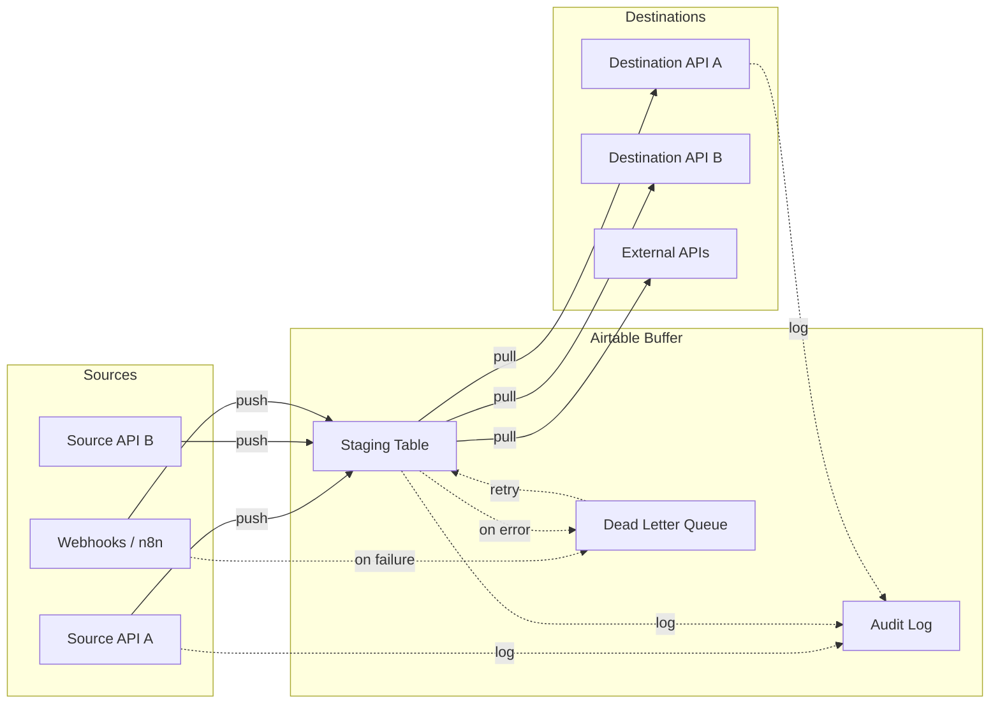

# Airtable Automation Toolkit

A Python toolkit with examples of Airtable staging, error queues, and syncing records between systems.

The examples use Airtable as a staging area between connected services. Check the code, access rules and error behavior against your own environment before use.

## Use Cases

- **Staging between systems** — Hold records for review between connected APIs
- **Dead-letter queue** — Capture failed webhook payloads and API errors for manual review and retry
- **Audit logging** — Record example events for review; decide which fields need masking in your environment
- **Bidirectional data sync** — Push/pull records between Airtable and external APIs with conflict detection

## Architecture



**Why Airtable as a buffer?**
- Human-readable: ops team can inspect and fix records without code
- Queryable: filter, sort, group by status — built-in UI
- Auditable: every record has a created/modified timestamp
- Review the current Airtable plan and limits against your expected workload
- API-first: clean REST API with 5 req/sec rate limit

## Installation

```bash
git clone https://github.com/lorenzespinosa/airtable-automation-toolkit.git
cd airtable-automation-toolkit

# Either install runtime deps directly...
pip install -r requirements.txt

# ...or install the package (and dev/test extras) from pyproject.toml
pip install -e ".[dev]"

cp .env.example .env
# Edit .env with your Airtable API key and base ID
```

> Requires Python 3.11+.

## Quick Start

```python
from src.airtable_client import AirtableClient

client = AirtableClient(
    base_id="appXXXXXXXXXX",
    api_key="patXXXXXXXXXX"
)

# Create a record
record = client.create_record("Leads", {
    "Name": "Jane Doe",
    "Email": "jane@example.com",
    "Source": "Website Intake",
    "Status": "New"
})

# List records with a filter
pending = client.list_records("Leads", filter_formula="{Status}='New'")

# Update a record
client.update_record("Leads", record["id"], {"Status": "Contacted"})
```

### Dead Letter Queue

```python
from src.dead_letter_queue import DeadLetterQueue

dlq = DeadLetterQueue(base_id="appXXX", api_key="patXXX", table_name="DLQ")

# Enqueue a failed operation
dlq.enqueue(
    source="n8n-intake-webhook",
    error="ConnectionError: Source API timeout",
    payload={"lead_id": 12345, "name": "Example Person"}
)

# List pending items for review
pending = dlq.list_pending()

# Retry a failed item
dlq.retry(record_id="recXXX")
```

### Audit Logger

```python
from src.audit_logger import AuditLogger

logger = AuditLogger(base_id="appXXX", api_key="patXXX")

# Example masking covers selected email, phone and dashed SSN patterns; review all logged fields
logger.log(
    action="lead_created",
    actor="n8n-intake-workflow",
    details={"email": "jane@example.com", "phone": "+14075551234", "ssn": "123-45-6789"}
)
# Stored as: {"email": "j***@example.com", "phone": "+140***1234", "ssn": "***-**-6789"}
```

### Staging Sync

```python
from src.staging_sync import StagingSync

sync = StagingSync(base_id="appXXX", api_key="patXXX", table_name="Staging")

# Push records to staging
sync.push_to_staging([
    {"external_id": "SRC-001", "name": "Record Alpha", "status": "open"},
    {"external_id": "SRC-002", "name": "Record Beta", "status": "closed"},
])

# Pull records matching a filter
open_cases = sync.pull_from_staging(filter_formula="{status}='open'")
```

## API Reference

### `AirtableClient(base_id, api_key)`

| Method | Description |
|---|---|
| `list_records(table, filter_formula=None, max_records=None, sort=None)` | List records with optional filter, pagination handled automatically |
| `get_record(table, record_id)` | Get a single record by ID |
| `create_record(table, fields)` | Create a record, returns the created record |
| `update_record(table, record_id, fields)` | Partial update (PATCH) a record |
| `delete_record(table, record_id)` | Delete a record by ID |
| `create_records(table, records)` | Batch create (10 per request) |
| `update_records(table, records)` | Batch update (each item needs `id` + `fields`) |
| `delete_records(table, record_ids)` | Batch delete (10 per request) |
| `mask_pii(data)` | Mask emails, phones, and SSNs for safe logging |

### `DeadLetterQueue(base_id, api_key, table_name="DeadLetterQueue")`

| Method | Description |
|---|---|
| `enqueue(source, error, payload)` | Add a failed item to the queue |
| `dequeue()` | Get and lock the oldest pending item |
| `retry(record_id)` | Mark an item for retry (increments `RetryCount`) |
| `resolve(record_id)` | Mark an item as resolved |
| `list_pending(limit=100)` | List all pending items |
| `list_all(status=None, limit=100)` | List items, optionally filtered by status |
| `get_payload(record_id)` | Retrieve and parse the stored JSON payload |

### `AuditLogger(base_id, api_key, table_name="AuditLog")`

| Method | Description |
|---|---|
| `log(action, actor, details=None, level="INFO")` | Write an audit log entry (PII auto-masked) |
| `log_error(action, actor, error, details=None)` | Write an ERROR-level entry |
| `query_logs(action=None, actor=None, level=None, limit=100)` | Query log records with filters |
| `mask_pii(data)` | Mask PII in a dict (emails, phones, SSNs) |

### `StagingSync(base_id, api_key, table_name="Staging")`

| Method | Description |
|---|---|
| `push_to_staging(records, source="api")` | Idempotent upsert into staging (checksum-based) |
| `pull_from_staging(filter_formula=None, status=None)` | Pull records from staging (data deserialized) |
| `detect_conflicts(records)` | Find records changed in both source and staging |
| `mark_synced(record_id)` / `mark_error(record_id, error)` | Update a staging record's status |
| `sync(source_callable, dest_callable, source_name="source")` | Full source → stage → destination cycle |

## Running Tests

```bash
pip install -e ".[dev]"
pytest tests/ -v --cov=src --cov-report=term-missing
```

71 unit tests run fully offline (the Airtable API is mocked). CI runs the suite on Python 3.11 and 3.12 via GitHub Actions ([`.github/workflows/ci.yml`](.github/workflows/ci.yml)).

## License

MIT License - see [LICENSE](LICENSE) for details.

## Performance Tips

- Use `AirtableClient.create_records()` / `update_records()` / `delete_records()` for true batch API calls (10 records per request — Airtable's limit)
- `batch_ops.batch_create()` iterates in chunks of 10 for simple bulk inserts
- Use `StagingSync` with checksums to skip writes for unchanged records
- The client throttles to 5 req/sec by default; tune `rate_limit_interval` if your plan allows more

---

<!-- hire-cta -->
## About Lorenz

I'm Lorenz Espinosa, an IT systems and automation consultant. This repository is public example material, not a record of client systems or results.

For a general inquiry, please leave out client names, records and confidential details: [Email](mailto:renzespinosa13@gmail.com) · [Portfolio](https://lorenzespinosa.github.io/) · [LinkedIn](https://www.linkedin.com/in/lorenz-leslie-espinosa/).
